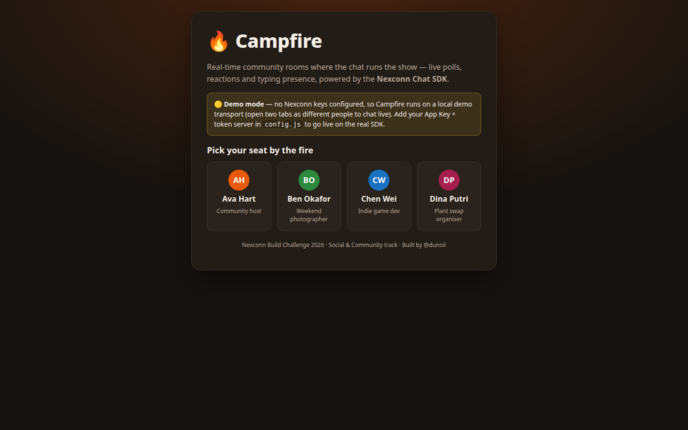
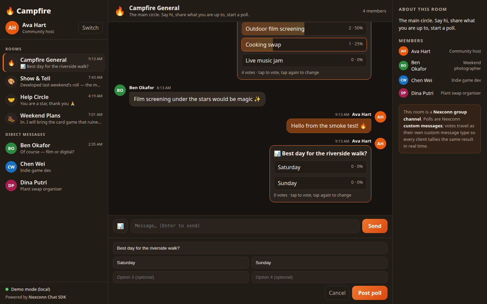

# 🔥 Campfire, Community Rooms powered by Nexconn

**Campfire is a real-time community chat app built on the [Nexconn Chat SDK](https://docs.nexconn.ai).**
Neighbours join topic rooms and direct messages, run **live polls inside the chat**, react to
messages, and see who is typing, everything driven by Nexconn group/direct channels and
Nexconn **custom messages**.

> **Nexconn Build Challenge 2026** entry · Track: **Social & Community** · Solo build by
> [@dunoil](https://github.com/dunoil) · Write-up: [WRITEUP.md](WRITEUP.md) ·
> Submission checklist: [SUBMISSION.md](SUBMISSION.md) · Demo script: [DEMO_VIDEO.md](DEMO_VIDEO.md)




## What it does

- **Topic rooms**, four community rooms (Campfire General, Show & Tell, Help Circle,
  Weekend Plans), each a Nexconn **group channel** with history, unread badges and
  last-message previews.
- **Direct messages**, 1:1 Nexconn **direct channels** between community members.
- **Live polls in chat**, anyone can post a poll from the composer. Polls and votes are
  Nexconn **custom message types** (`campfire:poll`, `campfire:vote`), so every client, 
  phone, second tab, second device, tallies the same results in real time. Tap to vote,
  tap again to change your vote.
- **Reactions**, 👍 ❤️ 😂 🎉 on any message via the SDK's message-reaction APIs, with
  live updates through reaction-change events.
- **Typing presence**, "Ben is typing…" via the SDK's typing-status events.
- **Persona picker**, pick one of four community members to enter as; in live mode each
  persona is a real Nexconn user ID with its own server-issued token.

## Two ways to run it

### 1. Demo mode (zero accounts, works anywhere)

If `public/config.js` has no App Key, Campfire runs on a built-in **local demo transport**:
messages persist in `localStorage` and sync between open browser tabs in real time
(BroadcastChannel), with friendly scripted neighbours keeping a solo session lively.
This is what the public static demo does until keys are added, the UI, polls, reactions
and typing all behave the same.

### 2. Live mode (real Nexconn cloud chat)

1. **Create a free Nexconn app** at [console.nexconn.ai](https://console.nexconn.ai)
   (registration creates an app on the Free plan, no credit card). Copy the **App Key**
   and **App Secret** from Key Management.
2. **Run the token server** in [`server/`](server/token-server.mjs) (zero-dependency
   Node 18+). It holds the App Secret, signs Nexconn Server API requests
   (`Signature = SHA1(AppSecret + Nonce + Timestamp)`) and issues user tokens:

   ```bash
   NEXCONN_APP_KEY=your-app-key NEXCONN_APP_SECRET=your-secret npm run server
   # optional: seed the four rooms + personas on Nexconn
   curl -X POST http://localhost:8787/seed
   ```

   Deploy it to any free Node host (Render, Railway, Fly.io, a VPS…), the App Secret
   must only ever live there, never in the web app.
3. **Point the web app at it** in `public/config.js`:

   ```js
   window.CAMPFIRE_CONFIG = {
     appKey: 'your-app-key',
     tokenServerUrl: 'https://your-token-server.example.com',
   };
   ```

4. `npm run build` and host `dist/` anywhere static (GitHub Pages works out of the box, 
   a ready workflow is in `.github/workflows/pages.yml`).

The app also creates/joins the rooms from the client on first connect
(`GroupChannel.createGroup` + `join()`), so seeding from the server is a convenience,
not a requirement.

## Develop

```bash
npm install
npm run dev        # Vite dev server
npm run build      # type-check + production build into dist/
npm run server     # token server (needs NEXCONN_APP_KEY / NEXCONN_APP_SECRET)
```

Headless smoke test (demo mode, 17 checks: gate → rooms → poll vote → reactions →
cross-tab live chat → DMs): see [`scripts/smoke-test.mjs`](scripts/smoke-test.mjs)
(needs `playwright-core` and a Chromium binary; set `CHROME_EXE`).

## How the Nexconn SDK is used

| Campfire feature | Nexconn API |
| --- | --- |
| Sign-in tokens | Server API `POST /v4/auth/access-token/issue` (signed, server-side) |
| Connect | `NCEngine.initialize({ appKey })`, `NCEngine.connect({ token })` |
| Rooms | `GroupChannel`, `GroupChannel.createGroup`, `join()`, Server API `/v4/group-channel/create` + `/join` for seeding |
| Direct messages | `DirectChannel` |
| Text messages | `SendTextMessageParams`, `channel.sendMessage()` |
| Polls & votes | `NCEngine.registerCustomMessages(...)` + `SendMessageParams(content, 'campfire:poll' / 'campfire:vote')` |
| History | `BaseChannel.createMessagesQuery(...)` with pagination |
| Channel list, unread | `BaseChannel.reload()`, `unreadCount`, `latestMessage`, `clearUnreadCount()` |
| Reactions | `message.addReaction()` / `removeReaction()`, `getMessageReactionSummaries()`, `onMessageReactionChanged` |
| Typing | `sendTypingStatus()`, `ChannelHandler.onTypingStatusChanged` |
| Live updates | `MessageHandler.onMessageReceived` |

## Project layout

```
index.html               app shell (loads runtime config.js, then the bundle)
public/config.js         runtime config: App Key + token server URL (empty = demo mode)
src/
  main.ts                UI: persona gate, channel list, stream, polls, composer
  nexconn-transport.ts   live transport, the real Nexconn SDK integration
  demo-transport.ts      local demo transport (same interface, zero accounts)
  types.ts               transport contract shared by both transports
  data.ts                personas + rooms (map 1:1 to Nexconn user IDs / group IDs)
server/
  token-server.mjs       zero-dependency token + seeding server (holds the App Secret)
docs/                    screenshots from the verified headless run
```

## Honest status

- ✅ App builds clean (`tsc` + Vite) and passes a 17-point headless smoke test in demo
  mode, including real cross-tab messaging, poll voting and reactions.
- ⏳ Live mode is fully implemented against the official SDK types and docs, and compiles
  against `@nexconn/chat` 26.x, it activates the moment an App Key + token server are
  configured. It has **not** been run against a real Nexconn app yet, because that needs
  a Nexconn developer account (sign-up is a submission step, tracked in
  [SUBMISSION.md](SUBMISSION.md)).

## License

MIT
